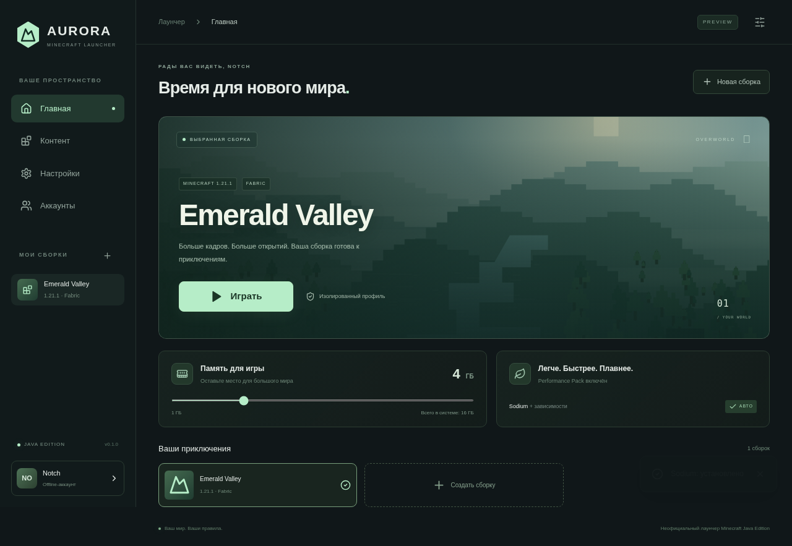

# Aurora Launcher

Minecraft Java Edition launcher — **Tauri 2 / Rust, React 19, Tailwind CSS, Framer Motion**. Windows x64 preview.

## Скачать и запустить

Windows EXE публикуются в Releases репозитория `ipoteca22848/legit-soft`, теги `aurora-v*`:

- `Aurora-Launcher-Portable.exe` — запуск без установки лаунчера; нужен Microsoft Edge WebView2.
- `Aurora Launcher_*_x64-setup.exe` — NSIS установщик с установкой WebView2 при необходимости.
- `SHA256SUMS.txt` — контрольные суммы файлов.

Portable сохраняет данные в AppData. Игровые файлы не включены: скачиваются с официальных источников. Интернет нужен для первой установки. Установленный offline-профиль запускается без обращения к Mojang.

1. **Аккаунты**: добавьте offline-ник (1–16 латинских букв, цифр, `_`) или подключите Microsoft.
2. **Новая сборка**: название, версия, Vanilla / Fabric / Forge / Quilt.
3. Опционально Performance Pack: Sodium для Fabric/Quilt, Embeddium (современная замена Rubidium) для Forge. Наличие зависит от версии; при отсутствии создайте профиль без пакета. Vanilla остаётся без модов.
4. **Играть**: автоматическая установка Java, client JAR, libraries, natives и assets.
5. **Контент**: моды, ресурспаки и шейдеры. Для шейдеров отдельно нужен совместимый Iris/Oculus.



Снимок интерфейса из браузерной проверки с тестовыми IPC-ответами; он не подтверждает запуск Minecraft.

## Возможности

- Тёмная glass-тема, плавные переходы, reduced motion; отдельный MP4/WebM HTTPS-фон профиля либо собственный локальный пейзаж.
- Кнопка запуска с прогрессом этапа; ползунок ОЗУ с резервом 2 ГБ для ОС.
- Offline UUID: MD5 UTF-8 `OfflinePlayer:<name>`, UUID v3, RFC 4122 variant. Регистр ника учитывается.
- Microsoft Device Authorization Grant → Xbox Live → XSTS → Minecraft Services → entitlement → профиль; обновление refresh token.
- Секреты в системном keyring / Windows Credential Manager; не в localStorage и config.json.
- Mojang version manifest v2, Fabric/Quilt metadata, официальный Forge installer с processors.
- Modrinth и CurseForge: фильтрация по версии/загрузчику, автоматические обязательные зависимости, защита от циклов.
- До 16 одновременных скачиваний, потоковая запись `.part`, checksum, rename, повторы, отмена.
- SHA-1 для Mojang, SHA-256 Java, SHA-512 Modrinth; защита ZIP от path traversal.
- OS/arch/features rules, Maven coordinates, classifiers, natives extraction, inherited loader manifest, запуск через `Command` без shell.
- Adoptium Java 8/17/21 (также 25, если запрашивает манифест), изолированная по профилю.
- JVM G1 baseline с выбранным Xmx и умеренным Xms. Полный серверный Aikar preset не навязывается клиенту.
- На время игры WebView уничтожается, Rust ждёт Java и создаёт окно заново. **10–20 МБ не гарантируются**; требуется замер на Windows.

## Microsoft и CurseForge

В **Настройки** укажите собственный **Microsoft Application (Client) ID**. Приложение должно разрешать personal Microsoft accounts, public client/device code flow и иметь доступ к Xbox/Minecraft Services API (может требоваться одобрение Microsoft). Client secret не используется. Пароль вводится только на официальном сайте Microsoft. Microsoft-вход не проверен с личным лицензионным аккаунтом в этой среде. Offline-режим не даёт доступа к online-mode серверам.

CurseForge требует разрешённый API-ключ CurseForge for Studios, вводимый в настройках. Пустое поле оставляет сохранённый ключ. Если автор не предоставляет `downloadUrl`, показывается ошибка с предложением установить файл с сайта, без обхода ограничений. Ключ и refresh tokens хранятся в системном хранилище.

## Структура исходников

```text
aurora-launcher/
├── package.json / package-lock.json
├── index.html / vite.config.ts / tsconfig.json
├── tailwind.config.cjs / postcss.config.cjs
├── public/backgrounds/overworld.svg  # локальный пейзаж
├── src/
│   ├── main.tsx                     # 4 страницы, профиль, IPC и события
│   └── styles.css                   # glass-тема, адаптация и motion
├── src-tauri/
│   ├── Cargo.toml / Cargo.lock
│   ├── build.rs / tauri.conf.json
│   ├── capabilities/default.json
│   ├── icons/icon.ico / icon.png
│   └── src/
│       ├── main.rs                  # Tauri commands, lifecycle, persistence
│       ├── model.rs                 # структуры manifest / offline UUID
│       ├── download.rs              # streams, hash, retries, concurrency
│       ├── engine.rs                # Java, loaders, assets, command builder
│       ├── auth.rs                  # Microsoft → Xbox → Minecraft, keyring
│       └── mods.rs                  # Modrinth / CurseForge / dependencies
├── README.md
└── RELEASE_NOTES.md
```

Release workflow — `.github/workflows/aurora-windows.yml` в корне репозитория. Основной Gradle-проект не изменяется.

Данные приложения:

```text
%APPDATA%/dev.aurora.minecraft.launcher/
├── config.json / config.bak.json
├── last-game-result.txt
└── instances/<UUID>/
    ├── versions/                    # Mojang и loader JSON, client JAR
    ├── libraries/ / natives/
    ├── assets/indexes/ / assets/objects/
    ├── runtime/8|17|21|25/          # Java внутри профиля
    ├── downloads/                   # установщики
    ├── mods/ / resourcepacks/ / shaderpacks/
    ├── saves/ / config/ / options.txt
    ├── content-locks/               # установленные версии Modrinth
    ├── prepared.json / resolved-version.json
    ├── launcher-game.log
    └── forge-install.log
```

Изоляция включает Java и immutable assets, что увеличивает расход диска. Общий read-only content-addressed cache можно добавить отдельно, не объединяя saves/mods/config.

## Сборка

Windows: Node.js 22+, Rust stable, MSVC C++ Build Tools / Windows SDK, WebView2.

```powershell
cd aurora-launcher
npm ci
npm run tauri dev
npm run build
cargo test --manifest-path src-tauri/Cargo.toml
npm run tauri build
```

Portable: `src-tauri/target/release/aurora-launcher.exe`. NSIS: `src-tauri/target/release/bundle/nsis/`.

## Проверки и ограничения preview

Unit-тесты проверяют эталон UUID Notch, traversal, Maven classifiers, feature rules, неизвестные placeholders. CI запускает Rust tests, TypeScript и Vite, затем собирает Windows portable и NSIS и проверяет появление главного окна EXE на Windows runner. Успешная компиляция не заменяет end-to-end проверку реального Minecraft и OAuth на Windows.

Цель релиза — Windows x64. В списке release-версии от 1.16.5; snapshots и legacy assets не поддерживаются. Auto-Java пока только Windows. Полный Aikar preset предназначен серверу, поэтому здесь используется консервативный G1 набор.

Поиск выдаёт 24 результата, CurseForge files выбираются среди первых 50 кандидатов. Нет импорта `.mrpack`, редактора/удаления профилей, автоматического обновления приложения и разрешения конфликтов уже установленных несовместимых модов. Моды из разных каталогов могут дублировать друг друга. Performance Pack доступен только для совместимых версий.

Отмена прерывает загрузки, но не уже запущенные Forge processors. Установка не транзакционна: успешно проверенные файлы остаются для следующей попытки. Побайтового прогресса установки Java/Forge нет: прогресс отображается по этапам. Для восстановления повреждённой сборки пока создайте новый профиль.

Игра пишет stdout/stderr в `launcher-game.log`. После завершения результат сохраняется в `last-game-result.txt`. Лаунчер не печатает полную команду и access token; сторонние моды могут создавать собственные журналы.

EXE не подписан сертификатом издателя. Неофициальный проект, не связан с Mojang/Microsoft.

Java 16, запрашиваемая Minecraft 1.17, заменяется на Java 17. Совместимость конкретных старых Forge-модов с Java 17 требует проверки.

В 0.1.2 добавлены официальный logging config Mojang, передача client ID/XUID, контроль SHA-1 Forge installer, ограничение частоты событий прогресса до 10 Гц и восстановление результата игры при пересоздании WebView.
